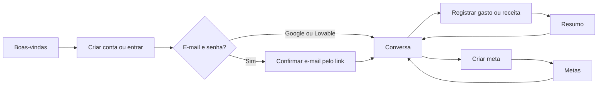
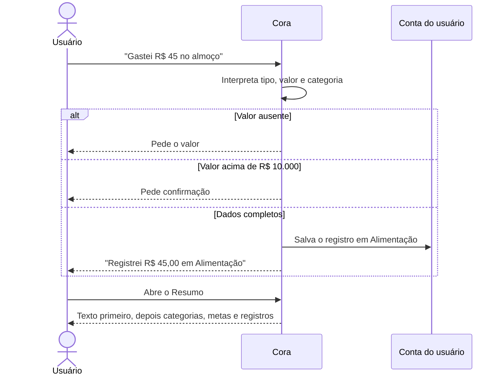
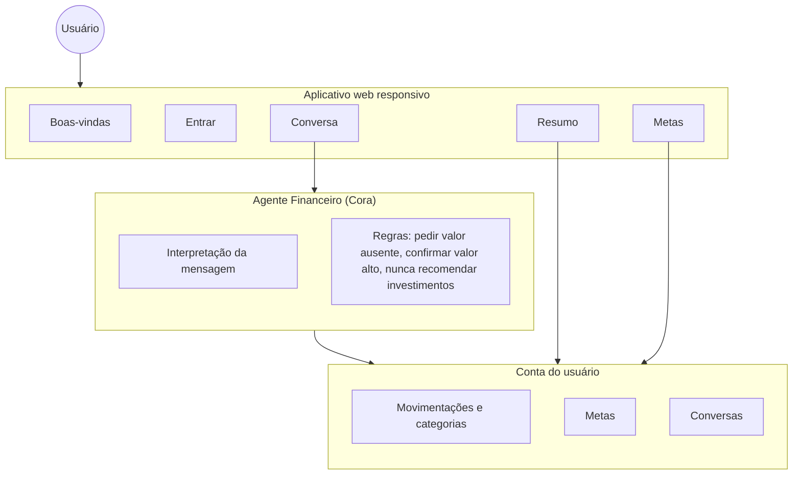

<div align="center">

# Cora

### Cuidar do dinheiro pode ser uma conversa.

Assistente financeiro conversacional para quem já desistiu de planilhas e de aplicativos que cobram esforço demais antes de entregar valor.


[Visão rápida](#visão-rápida) · [O produto](#o-produto-em-uso) · [Decisões de engenharia](#decisões-de-engenharia) · [Diferenciais](#diferenciais-comprováveis) · [PRD completo](#prd-final) · [Reflexão](#reflexão-sobre-o-processo)


</div>

---

## Visão rápida

| Pergunta | Resposta |
| --- | --- |
| **O que é?** | Um app em que gastos, receitas e metas são registrados escrevendo frases como "Gastei R$ 45 no almoço". |
| **Qual problema resolve?** | Abandono de apps financeiros por excesso de preenchimento manual, interface complexa, jargão e esforço contínuo. |
| **O que o torna interessante?** | O agente tem limites explícitos (nunca recomenda investimentos) e a acessibilidade foi tratada como requisito de produto desde o PRD, não como ajuste final. |
| **Como ver funcionando?** | Capturas reais na seção [O produto em uso](#o-produto-em-uso). Este repositório não publica um link do app. |
| **Quais tecnologias?** | Protótipo gerado no Lovable a partir de um PRD refinado com apoio do Copilot. Este repositório documenta o produto e não contém código-fonte. |
| **Onde estão os diferenciais?** | Seção [Diferenciais comprováveis](#diferenciais-comprováveis), cada um com a evidência correspondente. |

> **Transparência sobre o escopo.** O desafio da DIO avalia a capacidade de transformar uma ideia em conceito funcional com IA, sem exigir código. Este README separa o que as capturas mostram do que foi apenas descrito pela plataforma e do que não tem evidência. Nada aqui foi acrescentado para parecer mais completo.

## Sumário

- [Problema e oportunidade](#problema-e-oportunidade)
- [O produto em uso](#o-produto-em-uso)
- [Arquitetura da solução](#arquitetura-da-solução)
- [Do PRD ao produto](#do-prd-ao-produto)
- [Decisões de engenharia](#decisões-de-engenharia)
- [Diferenciais comprováveis](#diferenciais-comprováveis)
- [Qualidade e validação](#qualidade-e-validação)
- [Desafios e soluções](#desafios-e-soluções)
- [Limitações e próximos passos](#limitações-e-próximos-passos)
- [Reflexão sobre o processo](#reflexão-sobre-o-processo)
- [PRD final](#prd-final)
- [Estrutura do repositório, ferramentas e licença](#estrutura-do-repositório-ferramentas-e-licença)

---

## Problema e oportunidade

Quem quer controlar o dinheiro costuma tentar planilhas ou aplicativos de finanças e abandonar em poucas semanas. O PRD identifica as causas:

- preenchimento manual frequente;
- interfaces complexas;
- termos financeiros difíceis;
- esforço contínuo para manter o hábito;
- funcionalidades demais antes de o usuário perceber valor.

A consequência é a perda de visibilidade sobre os gastos e dos objetivos financeiros. A oportunidade está em inverter a lógica: em vez de pedir que a pessoa aprenda o sistema, o sistema aprende a linguagem da pessoa.

**Público-alvo:** jovens e adultos de 20 a 40 anos, com educação financeira baixa ou média, que não gostam de planilhas e preferem soluções rápidas pelo celular. O PRD exige ainda que o produto funcione para pessoas idosas, pessoas com deficiência e usuários de telas de tamanhos diferentes.

## O produto em uso

A Cora é um app web em que a conversa é a interface principal. O usuário escreve, a Cora interpreta, registra, classifica e confirma.

### Fluxo do usuário



### Ciclo de uma mensagem



### Galeria

**1. Boas-vindas.** Proposta de valor, exemplos reais de conversa e os três passos do produto: Converse, Entenda, Realize. O aviso no rodapé declara o limite do agente: orientação educativa, sem recomendação de investimentos e sem substituir um profissional.


**2. Definição e teste no Lovable.** A plataforma fez duas perguntas de definição, sobre o funcionamento da conversa (resposta: várias conversas separadas) e o armazenamento dos dados (resposta: na conta do usuário). Depois testou o assistente com uma conta de teste: "Gastei R$ 45 no almoço" foi registrado em Alimentação e apareceu no Resumo.


**3. Resumo, metas e acessibilidade.** Descrição das telas e dos recursos de acessibilidade do app gerado.


### Funcionalidades

| Funcionalidade | Como funciona | Evidência |
| --- | --- | --- |
| Registro por conversa | Frases comuns viram gastos ou receitas | Visível (capturas 01 e 02) |
| Classificação automática | Categoria atribuída à movimentação, como Alimentação | Visível (captura 02) |
| Correção e exclusão | Registros podem ser corrigidos ou excluídos | Descrito pelo Lovable (captura 02) |
| Metas | Progresso em porcentagem, quanto falta, guardar e retirar valores | Descrito pelo Lovable (captura 03) |
| Resumo | Texto com entradas, saídas, saldo e maior categoria, seguido de categorias, metas e lista de registros | Descrito pelo Lovable (captura 03) |
| Cuidados do agente | Pede o valor quando falta e confirma valores acima de R$ 10.000 | Descrito pelo Lovable (captura 02) |
| Conversas separadas | Várias conversas salvas na conta, com atalhos como "Registrar gasto" e "Ver resumo" | Descrito pelo Lovable (captura 03) |
| Acesso | E-mail e senha, Google ou Lovable, com confirmação de e-mail no cadastro por senha | Descrito pelo Lovable (captura 02) |

## Arquitetura da solução

O repositório não contém código, e a infraestrutura gerada pelo Lovable não foi inspecionada. O diagrama abaixo representa a **arquitetura lógica** evidenciada pelas capturas e pelo PRD, sem afirmar tecnologias internas.



Separação de responsabilidades que o PRD e o produto deixam claras:

- **Interface:** apresenta telas e atalhos, com a conversa no centro.
- **Agente:** interpreta linguagem natural e aplica as regras de conduta.
- **Dados:** tudo fica na conta do usuário, o que sustenta as várias conversas e o resumo consolidado.

## Do PRD ao produto

O PRD define o que o produto precisa fazer. A tabela cruza cada requisito relevante com o que existe e com o nível de evidência.

| Requisito do PRD | No produto | Evidência |
| --- | --- | --- |
| Conversa como interface principal | Tela de conversa e exemplos na landing | Visível |
| Registro de receitas e despesas | Gasto e receita registrados por frase | Visível |
| Classificação automática | Gasto de R$ 45 em Alimentação | Visível |
| Edição e correção de registros | Lista de registros com corrigir e excluir | Descrito |
| Metas com progresso e percentual | Porcentagem, valor faltante, guardar e retirar | Descrito |
| Resumo em texto primeiro | Texto antes de categorias e lista | Descrito |
| Confirmações inteligentes | Pede valor ausente; confirma valor muito alto | Descrito |
| Limites do agente | Aviso na landing; nunca recomenda investimentos | Visível e descrito |
| Ações rápidas | Atalhos "Registrar gasto" e "Ver resumo" | Descrito |
| Experiência para celular | Menu na parte inferior da tela | Descrito |
| Sugerir oportunidades simples de economia | Sem registro nas capturas | **Não evidenciado** |

### Design Universal rastreável

O PRD transforma o princípio em requisitos numerados (RDU-01 a RDU-10). Estes são os que têm correspondência nas evidências:

| Requisito | Correspondência |
| --- | --- |
| RDU-01 Registrar tudo pela conversa | Gasto, receita e meta pelo chat (visível) |
| RDU-02 e RDU-03 Linguagem simples e exemplos | Landing com "Sem planilhas, sem termos difíceis" e três frases de exemplo (visível) |
| RDU-04 e RDU-05 Explicar erros e confirmar o ambíguo ou incomum | Pede o valor ausente e confirma acima de R$ 10.000 (descrito) |
| RDU-06 Não depender só de cor | Receitas e gastos com sinal "+" ou "−" e ícone, além da cor (descrito) |
| RDU-07 Telas de tamanhos diferentes | Menu inferior no celular (descrito) |
| RDU-08 Tecnologias assistivas | Compatibilidade com leitores de tela (descrito) |
| RDU-10 Texto antes de elementos visuais | Resumo abre com texto (descrito) |

Os demais requisitos, como contraste adequado e redimensionamento de texto, não têm evidência direta nos materiais.

## Decisões de engenharia

| Decisão | Alternativa | Por que esta | Custo ou limitação |
| --- | --- | --- | --- |
| Conversa como interface principal | Formulários e menus de categorias | Remove a principal barreira de entrada apontada no problema | Depende da qualidade da interpretação da linguagem; erros precisam ser fáceis de corrigir |
| Várias conversas separadas, salvas na conta | Uma única conversa contínua | Organiza assuntos e preserva o histórico | Acrescenta complexidade e exige autenticação, o que não estava no PRD |
| Dados na conta do usuário | Dados apenas no dispositivo | Permite acessar de qualquer aparelho e consolidar o resumo | Exige login e confirmação de e-mail |
| Resumo começa em texto | Painel de gráficos | Atende iniciantes e leitores de tela (RDU-10) | Menos apelo visual imediato |
| Confirmar valores acima de R$ 10.000 | Registrar sem perguntar | Reduz erro de digitação em valores altos | O limiar foi um parâmetro de implementação, não do PRD |
| Escopo enxuto, com lista explícita do que fica de fora | Incluir integração bancária desde o início | Preserva foco e simplicidade para validar a hipótese da conversa | Menos automação no registro |
| Limites do agente definidos antes da construção | Deixar a IA decidir o comportamento | Evita conselhos de investimento e promessas de resultado | Respostas mais conservadoras |

## Diferenciais comprováveis

**1. Guardrails do agente definidos antes do produto.**
O PRD lista o que o agente pode e não pode fazer. A landing exibe o aviso de que a Cora não recomenda investimentos nem substitui um profissional, e a plataforma relata que o comportamento foi implementado. *Evidência:* PRD, captura 01 (visível) e captura 02 (descrito).

**2. Design Universal como requisito, não como acabamento.**
Dez requisitos numerados orientam navegação, linguagem, interface e acessibilidade. Decisões como sinal e ícone além da cor e resumo em texto primeiro derivam deles. *Evidência:* PRD e captura 03.

**3. Refinamento deliberado do PRD.**
O PRD inicial foi analisado e reescrito: o problema genérico foi aprofundado, o público amplo foi restringido a iniciantes, recursos vagos viraram funcionalidades de MVP e o agente ganhou responsabilidades, limites e tom. *Evidência:* documentação do projeto (análise do PRD original) e PRD final.

**4. Tolerância a erros no fluxo de registro.**
O produto pede o valor quando ele falta, confirma valores incomuns e permite corrigir ou excluir registros. Isso aplica diretamente o princípio de tolerância a erros. *Evidência:* PRD e captura 02 (descrito).

**5. Disciplina de escopo.**
O PRD nomeia o que fica fora do MVP (integração bancária, Open Finance, cartões, investimentos, gamificação, múltiplas contas, entre outros) e justifica a decisão pelo foco. *Evidência:* PRD.

## Qualidade e validação

**O que foi feito**

- Teste ponta a ponta com conta de teste, conduzido pelo Lovable: "Gastei R$ 45 no almoço" foi registrado em Alimentação e apareceu no Resumo (captura 02).
- Conferência de aderência entre o PRD e o comportamento descrito do produto (tabela [Do PRD ao produto](#do-prd-ao-produto)).

**O que o PRD define como validação, ainda não executado com usuários**

O MVP será considerado validado quando as pessoas conseguirem registrar movimentações sem treinamento, compreender gastos por categoria, criar ao menos uma meta, entender os resumos, usar o app com autonomia, interagir de forma recorrente com o agente e perceber o processo como mais simples que planilhas.

**O que não existe**

Testes automatizados, testes de usabilidade com pessoas reais, auditoria de acessibilidade, avaliação de segurança e métricas de desempenho. As funcionalidades marcadas como "descrito" dependem do relato da própria plataforma.

## Desafios e soluções

| Desafio | Solução |
| --- | --- |
| PRD inicial genérico: problema raso, público amplo e agente sem limites | Reescrita com problema aprofundado, público focado em iniciantes, funcionalidades enxutas e agente com responsabilidades, limites e tom |
| Manter a promessa de simplicidade sem abrir mão de acessibilidade | Design Universal convertido em requisitos numerados e verificáveis (RDU-01 a RDU-10) |
| Evitar que a IA assuma papel de consultor financeiro | Limites explícitos no PRD e aviso visível na interface |
| Decisões não especificadas durante a construção (conversas e armazenamento) | Perguntas respondidas na definição com o Lovable: várias conversas, dados na conta do usuário |
| Garantir coerência entre documento e produto | Cruzamento do PRD com as capturas, deixando explícito o que é visível, descrito ou não evidenciado |

## Limitações e próximos passos

**Limitações**

- Não há código-fonte neste repositório, e o app depende do projeto no Lovable.
- Não há link público do app neste repositório.
- Funcionalidades além do teste citado baseiam-se no relato da plataforma.
- O PRD prevê sugestões simples de economia, mas elas não aparecem nas capturas.
- Fora do MVP, por decisão do PRD: integração bancária, Open Finance, cartões de crédito, investimentos, gestão avançada de dívidas, múltiplas contas, previsões complexas, gamificação avançada, compartilhamento familiar e integrações externas.

**Próximos passos**

1. Validar o MVP com usuários do público-alvo, aplicando os sete critérios do PRD.
2. Auditar a acessibilidade com leitores de tela e verificar contraste e redimensionamento de texto.
3. Registrar no PRD as decisões surgidas na construção: autenticação, várias conversas e limiar de confirmação.
4. Evoluções previstas no PRD: relatórios mais detalhados, metas avançadas, integração bancária e personalização do agente.

## Reflexão sobre o processo

**O que funcionou bem.** Um PRD com problema, público, limites do agente e critérios de sucesso deu contexto suficiente para o Lovable fazer apenas duas perguntas de definição e entregar um produto coerente com o documento: tom educativo, agente sem recomendação de investimentos e acessibilidade em decisões concretas.

**O que exigiu atenção.** O produto passou do escopo do PRD ao incluir autenticação e várias conversas por usuário. A verificação se apoiou em um teste feito pela própria plataforma, que não substitui validação com pessoas reais.

**O que aprendi sobre conversar com IAs.** Quanto melhor o contexto, mais coerente o resultado; a revisão de um PRD genérico mostrou que problema, público e limites do agente precisam ser específicos; limitar o escopo gera mais valor no MVP do que acumular funcionalidades; e a IA pode ampliar o escopo por conta própria, o que exige revisar o que foi gerado.

## PRD final

Especificação usada como briefing do produto. Inclui problema, público, escopo, funcionalidades, agente, fluxos, telas, requisitos de Design Universal e critérios de validação.

<details>
<summary>Ver o PRD completo</summary>

````markdown
# PRD – App de Organização de Finanças Pessoais com IA Conversacional

## Visão Geral

O produto é um aplicativo de organização financeira pessoal baseado em conversas naturais com inteligência artificial.

Seu objetivo é permitir que pessoas iniciantes organizem suas finanças de forma simples, sem depender de planilhas, formulários complexos ou conhecimentos financeiros avançados.

A principal interface do produto é uma conversa com um Agente Financeiro capaz de interpretar linguagem natural, registrar movimentações financeiras, acompanhar metas e apresentar orientações educativas de forma simples e acessível.

O foco do MVP é validar se uma experiência conversacional é capaz de reduzir a barreira de entrada para o controle financeiro pessoal.

---

# Problema

Muitas pessoas desejam controlar seus gastos e melhorar sua organização financeira, mas abandonam rapidamente os métodos tradicionais porque:

- Exigem preenchimento manual frequente.
- Possuem interfaces complexas.
- Utilizam termos financeiros difíceis de compreender.
- Criam excesso de esforço para manter o hábito.
- Apresentam muitas funcionalidades antes que o usuário obtenha valor.

Como consequência, essas pessoas perdem visibilidade sobre seus gastos, deixam de acompanhar seus objetivos financeiros e não desenvolvem uma rotina sustentável de gestão do dinheiro.

---

# Público-Alvo

Jovens e adultos entre 20 e 40 anos que:

- Desejam ter maior controle sobre suas finanças.
- Nunca conseguiram manter o hábito de utilizar planilhas.
- Consideram aplicativos financeiros tradicionais complicados.
- Possuem baixa ou média alfabetização financeira.
- Preferem experiências simples e rápidas pelo celular.
- Estão iniciando sua jornada de educação financeira.

O produto também deve considerar usuários com diferentes níveis de experiência digital, incluindo:

- Pessoas iniciantes em tecnologia.
- Pessoas idosas.
- Pessoas com deficiência.
- Usuários utilizando dispositivos e telas de diferentes tamanhos.

---

# Proposta de Valor

Permitir que qualquer pessoa organize suas finanças conversando naturalmente com um assistente inteligente.

Em vez de navegar por formulários ou categorias complexas, o usuário pode registrar movimentações utilizando frases simples, como:

- "Gastei R$ 45 no almoço."
- "Recebi R$ 2.500 de salário."
- "Quero guardar R$ 1.000 para viajar."

O sistema interpreta a intenção, organiza as informações e apresenta orientações financeiras de forma clara e acessível.

---

# Objetivos do Produto

- Reduzir o esforço necessário para registrar movimentações financeiras.
- Incentivar a criação de hábitos financeiros saudáveis.
- Ajudar usuários iniciantes a compreender seus gastos.
- Tornar o controle financeiro mais acessível e menos intimidador.
- Oferecer acompanhamento simples e contínuo de metas financeiras.

---

# Objetivos do MVP

1. Permitir o registro de receitas e despesas através de linguagem natural.
2. Classificar automaticamente as movimentações em categorias simples.
3. Permitir a criação e acompanhamento de metas financeiras básicas.
4. Fornecer resumos financeiros simples e compreensíveis.
5. Validar a aceitação de um modelo de interação baseado em conversa.

---

# Escopo do MVP

## Incluído no MVP

- Registro conversacional de despesas.
- Registro conversacional de receitas.
- Classificação automática de categorias.
- Edição e correção de registros.
- Criação de metas financeiras.
- Acompanhamento básico de metas.
- Resumo financeiro simplificado.
- Agente Financeiro com orientações educativas.
- Experiência otimizada para dispositivos móveis.
- Aplicação dos princípios de Design Universal.

## Fora do Escopo do MVP

- Integração bancária.
- Open Finance.
- Cartões de crédito.
- Controle de investimentos.
- Recomendação de investimentos.
- Gestão avançada de dívidas.
- Múltiplas contas bancárias.
- Previsões financeiras complexas.
- Gamificação avançada.
- Compartilhamento familiar de finanças.
- Integrações com serviços externos.

---

# Funcionalidades Essenciais

## 1. Registro Conversacional de Movimentações

O usuário deve conseguir registrar receitas e despesas por meio de mensagens em linguagem natural.

Exemplos:

- "Gastei R$ 80 no mercado."
- "Paguei R$ 120 de gasolina."
- "Recebi R$ 3.000 de salário."

O sistema deve identificar:

- Tipo da movimentação.
- Valor.
- Descrição.
- Categoria sugerida.

Quando houver ambiguidade, o sistema deve solicitar esclarecimentos.

---

## 2. Classificação Automática

O sistema deve sugerir automaticamente uma categoria para cada movimentação.

Categorias iniciais:

- Alimentação
- Mercado
- Transporte
- Moradia
- Saúde
- Educação
- Lazer
- Outros

O usuário deve poder corrigir a categoria sugerida.

---

## 3. Gestão de Metas Financeiras

O usuário deve conseguir criar metas financeiras simples.

Exemplos:

- Guardar R$ 1.000.
- Economizar R$ 300 por mês.
- Juntar dinheiro para uma viagem.

O sistema deve apresentar:

- Valor da meta.
- Progresso atual.
- Percentual de conclusão.

---

## 4. Resumo Financeiro Simplificado

O sistema deve apresentar informações financeiras de fácil compreensão.

Conteúdo mínimo:

- Total de receitas.
- Total de despesas.
- Saldo atual.
- Categoria com maior gasto.
- Progresso das metas.

As informações devem ser apresentadas prioritariamente em formato textual simples.

---

## 5. Correção de Registros

O usuário deve conseguir corrigir ou ajustar informações registradas incorretamente.

Exemplo:

- Alterar categoria.
- Corrigir valor.
- Excluir movimentação registrada por engano.

---

# Agente Financeiro

## Objetivo

Ajudar o usuário a desenvolver hábitos financeiros mais conscientes através de orientação educativa, contextual e não julgadora.

---

## Responsabilidades

O Agente Financeiro deve:

- Registrar movimentações a partir da conversa.
- Esclarecer dúvidas sobre informações registradas.
- Apresentar resumos financeiros simples.
- Incentivar o acompanhamento das metas.
- Explicar padrões básicos de gastos.
- Sugerir oportunidades simples de economia.
- Ajudar na compreensão das informações financeiras.

---

## Limites de Atuação

O Agente Financeiro não deve:

- Recomendar investimentos específicos.
- Fornecer aconselhamento financeiro profissional.
- Garantir resultados financeiros.
- Tomar decisões pelo usuário.
- Criar estratégias de investimento.
- Fazer promessas de enriquecimento ou economia garantida.

---

## Tom de Voz

O agente deve ser:

- Amigável.
- Educativo.
- Simples.
- Inclusivo.
- Motivador.
- Respeitoso.
- Não julgador.

---

## Diretrizes de Comunicação

O agente deve:

- Utilizar frases curtas.
- Evitar termos financeiros complexos.
- Explicar conceitos quando necessário.
- Adaptar o detalhamento para usuários iniciantes.
- Confirmar informações ambíguas.
- Solicitar esclarecimentos quando não houver dados suficientes.

---

## Exemplos de Interação

Usuário:

"Gastei muito no mercado."

Resposta:

"Posso registrar essa compra para você. Qual foi o valor aproximado?"

---

Usuário:

"Como estão minhas finanças?"

Resposta:

"Você recebeu R$ X e gastou R$ Y neste período. Seu saldo atual é R$ Z. Sua maior categoria de gastos foi alimentação."

---

# Experiência Conversacional

## Princípios

A conversa é a principal forma de interação do produto.

O usuário deve conseguir realizar as tarefas mais importantes sem precisar navegar por menus complexos.

---

## Ações Rápidas

A interface pode oferecer sugestões visíveis como:

- Registrar gasto
- Registrar receita
- Criar meta
- Ver resumo

Esses atalhos servem como complemento à conversa, não como substituição.

---

## Confirmações Inteligentes

Quando existirem informações incompletas ou incomuns, o sistema deve solicitar confirmação.

Exemplos:

- Valor ausente.
- Categoria indefinida.
- Movimentação com valor muito elevado.

---

## Tratamento de Erros

Mensagens de erro devem:

- Explicar claramente o problema.
- Utilizar linguagem simples.
- Orientar o próximo passo.

Exemplo:

Em vez de:

"Formato inválido."

Utilizar:

"Não consegui identificar o valor da movimentação. Tente algo como: 'Gastei R$ 35 no almoço'."

---

# Fluxo Principal do Usuário

## Primeiro Acesso

1. Boas-vindas.
2. Explicação breve da proposta do aplicativo.
3. Apresentação da conversa como principal forma de uso.
4. Convite para registrar a primeira movimentação.
5. Opção de criar a primeira meta financeira.

---

## Uso Diário

1. Usuário envia uma mensagem.
2. Sistema interpreta a intenção.
3. Sistema registra ou responde à solicitação.
4. Sistema confirma a ação realizada.
5. Agente oferece orientação quando relevante.

---

## Consulta Financeira

1. Usuário solicita um resumo.
2. Sistema recupera informações registradas.
3. Sistema apresenta resultados em linguagem simples.
4. Sistema informa andamento das metas.

---

# Estrutura de Telas

## Tela 1 – Boas-vindas e Onboarding

Objetivo:

Apresentar o propósito do aplicativo e orientar o primeiro uso.

Funcionalidades:

- Introdução simples.
- Explicação da conversa como principal interação.
- Convite para registrar primeira movimentação.

---

## Tela 2 – Chat Financeiro

Objetivo:

Ser a área principal do produto.

Funcionalidades:

- Conversa com o Agente Financeiro.
- Registro de receitas.
- Registro de despesas.
- Dúvidas financeiras básicas.
- Sugestões rápidas.

---

## Tela 3 – Resumo Financeiro

Objetivo:

Apresentar a situação financeira atual.

Conteúdo:

- Receitas.
- Despesas.
- Saldo.
- Categorias de gastos.
- Metas.

---

## Tela 4 – Metas Financeiras

Objetivo:

Permitir acompanhamento de objetivos financeiros.

Conteúdo:

- Lista de metas.
- Progresso individual.
- Percentual de conclusão.

---

# Design Universal

## Diretriz Geral

O produto deve ser concebido para atender o maior número possível de usuários, independentemente de idade, familiaridade com tecnologia, capacidade física, capacidade cognitiva ou nível de educação financeira.

Design Universal deve orientar decisões de interface, comunicação, navegação e conteúdo.

---

## Princípios Aplicados

- Simplicidade e clareza.
- Linguagem acessível.
- Tolerância a erros.
- Flexibilidade de interação.
- Legibilidade.
- Compatibilidade com tecnologias assistivas.
- Consistência de navegação.
- Baixo esforço de uso.

---

## Requisitos de Navegação

- As ações essenciais devem estar acessíveis a partir do fluxo conversacional principal.
- O usuário não deve depender de múltiplos menus para realizar tarefas básicas.
- A navegação deve permanecer consistente em todas as telas.

---

## Requisitos de Linguagem

- Utilizar termos simples e cotidianos.
- Evitar jargões financeiros.
- Explicar conceitos quando necessário.
- Utilizar exemplos para facilitar a compreensão.

---

## Requisitos de Interface

- Botões devem possuir tamanho adequado para toque.
- Ícones devem ser acompanhados por texto sempre que possível.
- Elementos importantes devem possuir destaque visual adequado.
- A interface deve funcionar em telas pequenas e grandes.

---

## Requisitos de Apresentação de Informações

- Informações críticas não devem depender exclusivamente de cores.
- Resumos financeiros devem priorizar texto claro.
- Elementos visuais devem complementar a informação e não ser a única forma de compreensão.

---

## Requisitos de Acessibilidade

- Compatibilidade com leitores de tela.
- Estrutura de navegação previsível.
- Contraste adequado entre texto e fundo.
- Suporte ao redimensionamento de texto.
- Conteúdo compreensível sem dependência de percepção de cor.

---

## Requisitos Funcionais de Design Universal

- RDU-01: Registrar receitas, despesas e metas através da conversa principal.
- RDU-02: Utilizar linguagem simples e acessível.
- RDU-03: Oferecer exemplos quando houver dúvidas ou erros.
- RDU-04: Explicar mensagens de erro e sugerir correções.
- RDU-05: Confirmar informações ambíguas ou incomuns.
- RDU-06: Não depender exclusivamente de cores para comunicação.
- RDU-07: Garantir legibilidade em diferentes tamanhos de tela.
- RDU-08: Permitir uso com tecnologias assistivas.
- RDU-09: Priorizar explicações educativas.
- RDU-10: Apresentar informações financeiras primeiro em formato textual.

---

# Critérios de Validação do MVP

O MVP será considerado validado quando os usuários conseguirem:

1. Registrar movimentações sem necessidade de treinamento.
2. Compreender seus gastos por categoria.
3. Criar pelo menos uma meta financeira.
4. Entender os resumos fornecidos pelo sistema.
5. Utilizar o aplicativo com autonomia.
6. Interagir com o Agente Financeiro de forma recorrente.
7. Perceber o processo como mais simples do que planilhas ou métodos tradicionais.

---

# Indicadores de Sucesso

Indicadores qualitativos a serem observados durante a validação:

- Facilidade percebida no registro de movimentações.
- Clareza das respostas do agente.
- Compreensão dos resumos financeiros.
- Facilidade de navegação.
- Compreensão das metas financeiras.
- Percepção de utilidade das orientações do agente.
- Capacidade de uso por pessoas com diferentes níveis de experiência digital.

---

# Possíveis Evoluções Futuras

Itens considerados fora do MVP, mas possíveis para versões futuras:

- Integração bancária.
- Sincronização financeira automática.
- Metas avançadas.
- Relatórios mais detalhados.
- Gamificação.
- Gestão de múltiplas contas.
- Planejamento financeiro avançado.
- Recursos colaborativos familiares.
- Personalização avançada do agente.

---

# Resumo do Produto

O produto é um assistente financeiro conversacional que ajuda pessoas iniciantes a registrar despesas, acompanhar metas e compreender melhor seus hábitos financeiros por meio de uma experiência simples, educativa e inclusiva.

Toda a solução deve priorizar simplicidade, autonomia, acessibilidade e compreensão, utilizando Design Universal como princípio transversal em todas as decisões de produto, experiência e comunicação.
````

</details>

## Estrutura do repositório, ferramentas e licença

```text
.
├── README.md
└── docs
    └── screenshots
        ├── 01-cora-tela-boas-vindas.png
        ├── 02-lovable-teste-do-assistente-e-telas.png
        └── 03-lovable-resumo-metas-e-acessibilidade.png
```

As capturas 02 e 03 tiveram a barra de endereço do navegador removida; o conteúdo da interface permanece integral.

**Ferramentas:** Lovable (prototipação e geração do app), Copilot (elaboração e revisão do PRD) e GitHub (versionamento e publicação).

**Base do desafio:** [dio-lab-vibe-coding-app-financas](https://github.com/digitalinnovationone/dio-lab-vibe-coding-app-financas), da Digital Innovation One.

**Licença:** projeto de portfólio com fins educacionais; nenhum arquivo de licença foi definido neste repositório.
